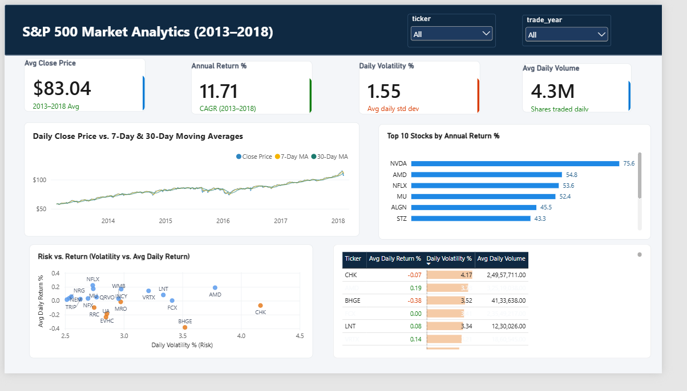

# S&P 500 ETL Pipeline & PostgreSQL Query Optimization

An end-to-end Python and PostgreSQL data pipeline that ingests 5 years of historical S&P 500 stock prices into a normalized relational schema, runs SQL window-function analytics, and benchmarks B-Tree indexing decisions using `EXPLAIN ANALYZE`.

## Dashboard Preview



[Download Interactive Power BI Report (.pbix)](sp500_dashboard.pbix?raw=true)

## Project Structure

```text
sp500-etl-sql-analytics/
├── data/
│   └── raw/                  # Local Kaggle CSV dataset (gitignored)
├── sql/
│   ├── 01_schema.sql         # Normalized table definitions and constraints
│   ├── 02_analytics.sql      # Analytical queries (CTEs, window functions)
│   └── 03_indexing.sql       # EXPLAIN ANALYZE benchmarks and B-Tree index tuning
├── src/
│   └── etl_pipeline.py       # Pandas + SQLAlchemy ETL script
├── .gitignore
├── requirements.txt
└── README.md
```

## Tech Stack

* **Database:** PostgreSQL
* **ETL:** Python, Pandas, SQLAlchemy, psycopg2-binary, python-dotenv
* **Query Analysis:** PostgreSQL `EXPLAIN ANALYZE`
* **Visualization (Planned):** Power BI Desktop connected directly to PostgreSQL

## Database Design & ETL

* **Normalized Schema (`sql/01_schema.sql`):** Separates company metadata (`stocks`, 505 tickers) from daily OHLCV market records (`daily_prices`) using foreign keys to avoid repeating ticker strings across hundreds of thousands of rows.
* **ETL Pipeline (`src/etl_pipeline.py`):** Reads `data/raw/all_stocks_5yr.csv` with Pandas, cleans and prepares records for the relational schema, and loads them into PostgreSQL via SQLAlchemy using credentials stored in `.env`.

## SQL Analytics (`sql/02_analytics.sql`)

* Time-series market analysis built with Common Table Expressions (CTEs) and SQL window functions.
* Calculates 7-day and 30-day rolling moving averages per ticker using `AVG() OVER (PARTITION BY ... ORDER BY ... ROWS BETWEEN ...)` alongside relational joins across `stocks` and `daily_prices`.

## Query Optimization & Indexing Benchmarks (`sql/03_indexing.sql`)

Indexes were evaluated using PostgreSQL's `EXPLAIN ANALYZE` planner metrics rather than added blindly.

| Query | Baseline Plan & Time | Post-Index Plan & Time | Outcome |
| :--- | :--- | :--- | :--- |
| **2017 Date-Range Filter** (`daily_prices`) | `Seq Scan` — 492,997 rows filtered (**171.57 ms**) | `Bitmap Index Scan` on `idx_daily_prices_trade_date` (**19.52 ms**) | **~8.8x faster** — Kept index |
| **AAPL 7d/30d Moving Average** (`stocks` + `daily_prices`) | `stocks_pkey` scan — 504 rows filtered (**5.95 ms**) | Planner still selected `stocks_pkey` over `idx_stocks_ticker` (**9.33 ms**, identical plan cost) | **Dropped index** (`DROP INDEX IF EXISTS`) |

**Key Engineering Takeaway:** On a 505-row dimension table like `stocks`, PostgreSQL's cost-based planner scans the primary key in under 0.1 ms. Dropping `idx_stocks_ticker` eliminates unnecessary index maintenance overhead during ETL writes without sacrificing read performance.

## Setup & Usage

### 1. Create a Virtual Environment & Install Dependencies
```bash
python -m venv venv
# Windows (PowerShell)
.\venv\Scripts\Activate.ps1
# macOS / Linux
source venv/bin/activate

pip install -r requirements.txt
```

### 2. Configure Environment Variables
Create a `.env` file in the project root with your local PostgreSQL credentials:
```env
DB_HOST=localhost
DB_PORT=5432
DB_NAME=sp500_db
DB_USER=postgres
DB_PASSWORD=your_password
```

### 3. Download the Dataset
Download the [S&P 500 Stock Data](https://www.kaggle.com/datasets/camnugent/sandp500) CSV from Kaggle and place it at:
```text
data/raw/all_stocks_5yr.csv
```

### 4. Run the Schema, ETL, and SQL Scripts
1. Execute `sql/01_schema.sql` in PostgreSQL (via `psql` or pgAdmin).
2. Run the ETL script to populate the database:
   ```bash
   python src/etl_pipeline.py
   ```
3. Execute `sql/02_analytics.sql` for analytical queries and `sql/03_indexing.sql` to reproduce the `EXPLAIN ANALYZE` benchmarks.
